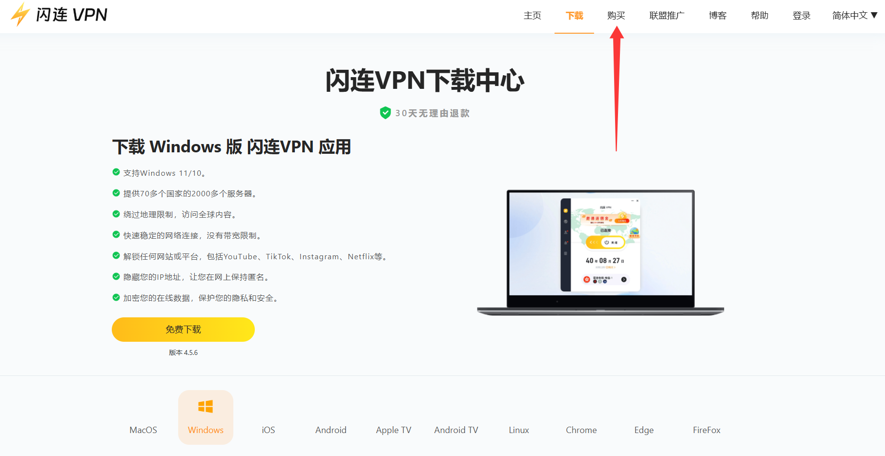
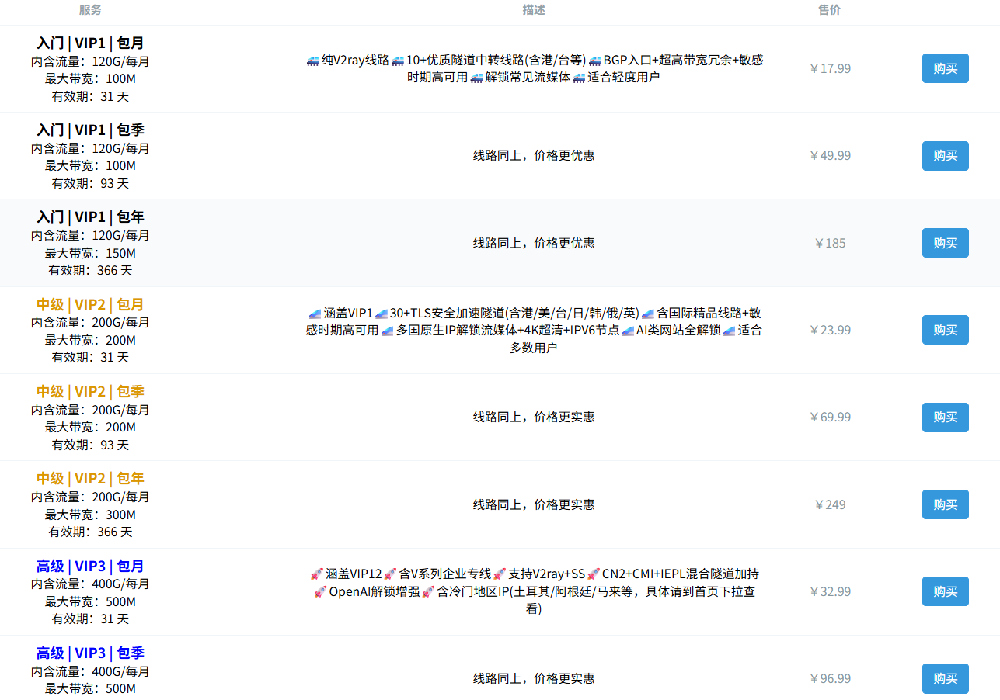
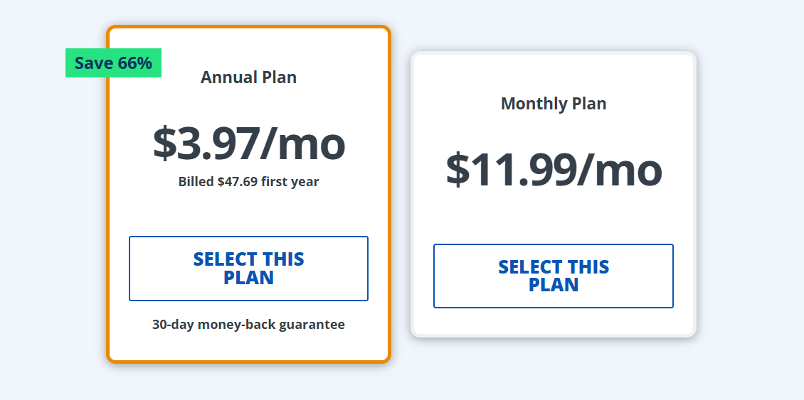
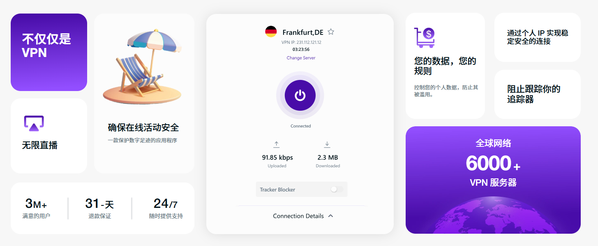

# 
Windows电脑翻墙教程：2026最好用的PC端电脑VPN推荐

最近更新于：2026年11月24日

现如今，虽然很多人习惯用手机翻墙，但真要查阅专业资料、看4K超清流媒体、处理外贸订单或进行跨国远程办公，最终还是得回归大屏幕的电脑。尤其是Windows电脑，依然是绝大多数人日常学习、工作和娱乐的主力设备。

可惜的是，随着防火长城的不断升级，国内好用的电脑VPN软件变得越来越少。大部分你能在网上搜到的PC端VPN，不是连接困难，就是速度慢得像在看幻灯片，体验非常糟糕。如果你随便去搜那些打着“永久连得上”或“完全免费”旗号的电脑版VPN，绝大多数都是在挂羊头卖狗肉。真用起来不仅速度慢，更要命的是隐私根本得不到保障，甚至有不少小作坊赚一波钱就卷款跑路。

作为一个常年在国内和国外来回奔波的老网民，市面上的主流电脑翻墙软件我基本都折腾过。那么，哪些电脑端VPN值得掏钱？哪些电脑版VPN用了不会踩雷？电脑VPN连不上了该怎么救急？这篇文章就给大家好好聊聊这些问题，帮你避开那些劣质机场梯子，少交智商税。

友情提示：如果你不想花太多时间看长篇大论，只想赶紧找一款好用的PC端VPN，可以直接从下面这四款中挑选。其中，闪连VPN是我们最推荐的一款，综合表现比较均衡，适合绝大多数用户！

<blockquote>

* **国内PC电脑翻墙首选：<a href="https://wallvpn.com/go/lightxtremevpn/">闪连VPN</a>**。如果你想在Windows电脑上找一款翻墙稳定、速度快，而且不需要折腾各种配置的VPN，闪连VPN是我最推荐的一款。**它最大的优势就是综合体验比较好，不仅翻墙稳定、连接速度快，而且在隐私安全和易用性方面也做得不错**。**闪连VPN为Windows、Mac、安卓、iOS、Linux等常见设备都提供了专用的APP客户端**，下载安装后基本就能一键连接，**不需要另外安装Clash、v2rayN、v2rayNG、小火箭等第三方代理工具**。它在全球70多个国家部署了2000多台服务器，支持WireGuard、VLESS等协议，还提供数据加密、DNS泄漏保护等安全功能。**闪连VPN还支持微信、支付宝等国内常用的支付方式，并提供30天退款保障**。对于大多数国内用户来说，无论是日常浏览国外网站、使用ChatGPT，还是看YouTube、Netflix，闪连都是一款值得优先考虑的电脑VPN。

* **高性价比电脑VPN推荐：<a href="https://wallvpn.com/go/yiy/">YIY机场</a>**。**如果你更在意翻墙稳定性、翻墙速度和套餐价格，而且平时习惯使用Clash这类代理工具，那么YIY机场就很值得考虑**。它是一家专门面向国内翻墙用户的机场服务商，**最大的优势就是翻墙很稳定、连接速度也很快，而且价格非常便宜**。YIY提供多种套餐，**入门套餐每月仅需17.99元，就能获得120GB流量**，对于日常上网、看YouTube、使用ChatGPT来说基本够用了。它还提供高端专线套餐，包括面向游戏和低延迟需求的IPLC内网专线，最高带宽可达1000Mbps。**YIY机场支持支付宝付款**，也能解锁Netflix、ChatGPT等海外服务。对于经常翻墙、追求稳定高速连接，又不想每个月花太多钱的用户来说，YIY确实是一个性价比很高的选择。

* **老牌电脑VPN推荐：<a href="https://wallvpn.com/go/strong-vpn/">StrongVPN</a>**。StrongVPN是一家成立于1995年的老牌美国VPN服务商，背靠纳斯达克上市科技巨头Ziff Davis，资金实力非常雄厚。相比市面上那些小规模的机场梯子，**StrongVPN不仅有强大的企业实力（无跑路风险）和隐私安全保护能力，而且在设备兼容性、APP易用性、全球服务器节点（解锁地域限制）、功能配置和售后保障等方面也更有优势**。StrongVPN为Windows、Mac、安卓、iOS等常见设备都提供了专用的客户端，APP界面非常简洁，没有花里胡哨的弹窗和复杂设置，基本就是一键连接。在应对网络封锁方面，StrongVPN还内置了Scramble流量混淆技术，可以有效隐藏VPN的流量特征，降低被防火墙识别和封锁的概率。同时，它还支持WireGuard、OpenVPN、IKEv2等主流VPN协议，兼顾连接速度与隐私安全。最厚道的是，**一个账号最多支持12台设备同时在线**。目前StrongVPN的年度套餐首年优惠约66%，折合**每月仅需3.97美元，还提供24小时在线客服和30天退款保障**。如果你更看重隐私安全、公司实力和长期使用保障，那么StrongVPN绝对值得考虑。

* **国际知名电脑VPN推荐：<a href="https://wallvpn.com/go/purevpn/">PureVPN</a>**。PureVPN同样是一家经营多年的国际知名VPN服务商，**在隐私安全保护、解锁地域限制、设备兼容性和售后保障等方面都有不错的表现**。它在全球65多个国家部署了6000多台高速服务器，服务器带宽最高可达20Gbps，无论是访问国外网站、观看4K流媒体，还是进行跨国远程办公，都能提供不错的连接体验。PureVPN为Windows、Mac、安卓和iOS等常见设备提供专用客户端，支持WireGuard等安全协议，还配备了自动断线保护、拆分隧道等实用功能。在隐私保护方面，PureVPN采用严格的无日志政策，还引入了业界少见的随时无通知审计机制，让它的无日志政策更有说服力。此外，它还提供专属独立IP和端口转发等附加功能，对于需要固定海外IP的跨国电商用户，以及有BT下载、远程访问等需求的用户来说都比较实用。在价格方面，**PureVPN的长期套餐折合每月仅需2美元左右，还提供24小时在线客服和31天退款保障**。如果你想找一家安全性高、服务器节点多、公司背景可靠的国际VPN品牌，PureVPN也是一个不错的选择。

</blockquote>

总的来说，以上四款电脑VPN各有优势，也都有各自的不足，大家可以根据自己的需求来选择。**如果你想找一款翻墙稳定、速度快、安全性不错，而且操作简单、设备兼容性好的VPN，那么闪连VPN是综合体验最好的选择，适合绝大多数国内用户长期使用**。虽然闪连VPN在隐私安全保护方面不如StrongVPN、PureVPN等国际老牌VPN那么成熟，在价格方面又比普通机场梯子略贵一些，但整体表现比较均衡，没有明显的短板。**如果你更看重翻墙稳定性、连接速度和性价比，那么YIY机场更值得考虑**。因为YIY机场不仅翻墙体验更好，而且价格很便宜，性价比非常高。不过，YIY没有专用的APP客户端，需要搭配Clash等第三方代理工具使用，在隐私安全、服务器节点和售后保障方面也不如国际大牌VPN完善。**而StrongVPN和PureVPN作为国际知名的老牌VPN服务商，在公司实力、隐私安全、全球服务器节点、设备兼容性和售后保障等方面更有优势，还提供30天左右的退款保障，基本不用担心跑路的问题**。唯一需要注意的是，它们在中国大陆的翻墙稳定性和连接速度方面，可能不如专门针对国内网络环境优化的机场梯子。**简单来说，追求综合体验选闪连VPN；追求翻墙稳定性、连接速度和性价比就选YIY机场；更看重隐私安全、公司实力和长期使用保障，就选StrongVPN或PureVPN**。

## 如何挑选最佳电脑VPN软件？

很多朋友一提到给电脑翻墙，第一反应就是“在网上随便下载一个VPN装上不就行了嘛”。但现实情况是，到了2026年，想找一款在中国大陆长期稳定好用的电脑VPN，其实并不容易。如果选错了工具，不仅可能经常连不上、速度慢得让人崩溃，还可能遇到隐私泄露、商家卷款跑路等问题。因此，大家在挑选电脑VPN时，最好重点关注以下几个方面：

**抗审查能力与中国区连通率**：这是最重要的标准。别去迷信国外VPN宣传的“全球最快”或“无限流量”，不管宣传得多好，如果在防火长城（GFW）的封锁下根本连不上，那就全都白搭。挑选电脑VPN时，首先要看它能不能在中国大陆稳定连接，有没有针对网络封锁采取相应的技术措施，比如流量混淆、专线优化等。此外，还要看它在网络封锁比较严重的时候，能不能及时切换线路、恢复连接。如果连不上网，那么其他功能再好也没用。

**连接速度与服务器节点**：电脑端翻墙的需求和手机不太一样。你在电脑上可能需要下载大型文件、观看Netflix的4K超清流媒体，或者处理跨国办公文件。这就要求VPN服务商拥有足够的服务器资源和网络带宽，最好还能提供10Gbps甚至20Gbps的高速服务器。不过，服务器带宽高不代表实际连接速度一定快，线路质量和网络拥堵情况同样重要。尤其要看它有没有靠近中国大陆的香港、日本、新加坡、台湾等低延迟节点，这些都会影响你在晚高峰的实际使用体验。

**隐私保护与安全功能**：Windows电脑里通常存有大量工作资料、个人账号和重要文件，因此VPN的隐私安全也不能忽视。靠谱的电脑VPN最好坚持严格的无日志政策（有独立第三方审计更好），并且支持WireGuard、OpenVPN等成熟的安全协议，以及Kill Switch（网络锁）、DNS泄漏保护等安全功能。这样即使VPN意外掉线，也能尽量避免真实IP地址泄露。千万别去碰那些来路不明的免费VPN或破解版软件，否则不仅隐私得不到保障，还可能存在恶意收集用户数据等风险。

**客服响应速度与退款保障**：大家千万别小看售后这一点。网络封锁是动态变化的，当你的电脑VPN连不上、节点大面积失效的时候，能不能及时找到人工客服并获得解决方案，会直接影响你的使用体验。尤其是那些提供24小时在线客服的VPN服务商，遇到问题时通常更方便沟通。另外，还要关注VPN服务商是否提供一定期限的退款保障，这样即使购买后发现不适合自己，也有机会申请退款，减少不必要的损失。

**购买渠道与支付门槛**：挑选电脑VPN时，还应该考虑付款是否方便。除了常规的信用卡和PayPal，如果能支持支付宝或者微信支付，自然更符合中国用户的支付习惯。如果你比较重视付款隐私，也可以看看是否支持加密货币等其他支付方式。

总而言之，最适合中国用户的电脑VPN，首先得能稳定翻墙、连接速度快，其次还要兼顾隐私安全、服务器节点、操作便利性和售后保障。至于具体怎么选，就看你更在意哪方面了。不要只图便宜，也没必要盲目追求国外大牌，找到一款适合自己、长期用着省心的VPN才是最重要的。

## 2026年最好用的电脑VPN推荐

说了这么多选购原则，估计大家最想知道的还是：“到底哪款电脑VPN软件最靠谱？”说实话，现在真正能扛得住防火长城反复封锁、在中国大陆长期稳定使用的电脑VPN，确实已经不多了。下面这份推荐名单，是我们结合过去几年的实际使用体验、连接速度和抗封锁表现筛选出来的。无论你是Windows还是Mac用户，也无论是为了看4K流媒体、使用ChatGPT，还是跨国远程办公，都可以从这四款电脑翻墙工具中找到适合自己的选择。接下来就不绕弯子了，直接看看2026年有哪些值得推荐的电脑VPN。

### 国内PC电脑翻墙首选：<a href="https://wallvpn.com/go/lightxtremevpn/">闪连VPN(1.18元/天)</a>

如果你想在Windows电脑上找一款翻墙稳定、速度快，而且操作简单、安全性也不错的VPN，那么闪连VPN绝对值得优先考虑。**在我推荐的这四款电脑翻墙工具中，闪连VPN的综合表现最为均衡**。它不像一些传统机场梯子那样需要自己折腾订阅链接和代理客户端，也不像部分国外大牌VPN那样容易受到国内网络封锁的影响。无论你是刚接触翻墙的新手，还是经常需要访问国外网站的老用户，闪连VPN都比较适合长期使用。

在翻墙稳定性和连接速度方面，闪连VPN的表现尤其值得一提。它支持Shadowsocks、VLESS、WireGuard等多种协议，并针对不同网络环境提供相应的连接方式，能够更好地应对国内复杂的网络封锁。闪连VPN在全球70多个国家、1000多座城市部署了2000多台服务器，覆盖美国、日本、新加坡、韩国、德国、澳大利亚等热门地区。对于国内用户来说，连接日本、新加坡等距离较近的亚洲节点，通常更容易获得较低的网络延迟。如果你平时喜欢在电脑上看YouTube、Netflix的4K高清视频，或者需要使用ChatGPT、Gemini等海外AI工具，闪连VPN都能满足这些常见的翻墙需求。

闪连VPN另一个很大的优势就是简单易用，而且设备兼容性非常好。**它为Windows、Mac、安卓、iOS、Linux、Apple TV、Android TV等常见设备都提供了专用的APP客户端**，还支持Chrome、Edge、Firefox等浏览器扩展。对于Windows电脑用户来说，直接下载安装官方客户端，登录账号后点击开启按钮，基本就能一键连接，不需要另外安装Clash、v2rayN等第三方代理工具。它的APP界面也非常简洁，没有复杂的配置选项，还支持自动匹配最快线路、智能模式和全局代理模式。如果不想自己挑选节点，直接使用自动匹配功能就行，非常简单方便。

在隐私安全方面，闪连VPN同样做得不错。它支持WireGuard等安全协议，并采用AES-256-GCM、ChaCha20-Poly1305等加密算法，能够对网络传输的数据进行加密保护。同时，它还提供DNS泄漏保护、隐藏真实IP地址等功能，并承诺执行零日志政策，不记录用户的在线活动。虽然在企业背景和第三方安全审计等方面，闪连VPN还不能与国际老牌VPN相提并论，但对于日常浏览国外网站、观看流媒体以及使用海外AI工具的普通用户来说，它提供的安全功能已经比较全面。

在价格和付款方面，闪连VPN也充分考虑到了国内用户的使用习惯。目前它提供周付、月付、季付和年付四种套餐，其中周付套餐每天4.19元，月付套餐每天2.35元，季付套餐每天1.54元，而年付套餐最划算，**每天仅需1.18元**。相比一些国际大牌VPN，闪连VPN的订阅价格还是比较容易接受的。付款方式也非常丰富，除了常规的信用卡、PayPal，**还支持支付宝、微信支付**、银联以及USDT，不需要专门办理海外信用卡。另外，**闪连VPN还提供30天退款保障**，大家在购买前可以查看具体的退款条件。

<a href="https://wallvpn.com/go/lightxtremevpn/">立即获取闪连VPN</a>

****

### 高性价比电脑VPN推荐：<a href="https://wallvpn.com/go/yiy/">YIY机场(17.99元/月)</a>

如果你更看重翻墙稳定性、连接速度和性价比，那么YIY机场绝对值得考虑。YIY是一家专门面向国内翻墙用户的机场服务商，主要提供高速专线和多种代理节点，针对国内网络环境做了不少优化。虽然它在隐私安全保护和设备兼容性方面不如国际老牌VPN那么完善，但胜在**翻墙稳定、速度快，而且价格非常便宜**。对于经常需要访问国外网站、观看流媒体或者使用海外AI工具的用户来说，YIY是一个性价比很高的选择。

在翻墙线路和服务器节点方面，YIY机场提供BGP入口、IEPL/IPLC专线等多种线路，节点覆盖香港、日本、台湾、新加坡、美国、韩国、英国等热门地区，还有土耳其、阿根廷、印度等相对冷门的节点。其中，香港、日本、新加坡等亚洲节点距离中国大陆较近，通常能够提供比较低的网络延迟。而且，YIY针对国内网络环境优化了线路，在网络封锁比较严重或者晚高峰时段，也能尽量保持稳定的连接速度。无论是日常浏览国外网站、观看YouTube和Netflix，还是使用ChatGPT等海外AI工具，都能满足大多数用户的需求。

YIY机场另一个很大的优势就是套餐选择多，而且价格确实便宜。目前它主要提供VIP1、VIP2、VIP3和VIP8四个等级。其中，**入门级VIP1套餐每月仅需17.99元，包含120GB流量**，对于日常浏览网页、查阅资料、使用ChatGPT来说基本够用了。如果你对连接速度和线路质量有更高的要求，还可以选择VIP2和VIP3套餐，月付价格分别为23.99元和32.99元，不仅流量更多，还能使用更高级别的线路。而VIP8旗舰套餐每月49.98元，包含500GB流量，还能使用IPLC游戏专线和独立的OpenAI解锁通道。对于经常玩外服游戏、观看4K流媒体或者重度使用AI工具的用户来说，VIP8会更加合适。另外，YIY还提供季付和年付套餐，购买时间越长，平均每月的价格也越便宜，VIP8年付套餐还会额外赠送Netflix共享账号。

在设备兼容性和易用性方面，YIY虽然不像闪连VPN那样提供独立开发的APP客户端，但它为Windows、Mac、安卓、iOS和Linux等常见设备都提供了相应的使用教程。对于Windows电脑用户，YIY推荐使用Clash Neo客户端。这是一款基于Clash Verge二次开发的客户端，支持YIY自研的Nexo协议，能够更好地适配它的专用线路，提升抗封锁能力和连接稳定性。而且操作起来也不算复杂，下载安装客户端后，可以直接通过一键导入或者复制订阅链接的方式添加节点，不需要手动填写复杂的代理配置。此外，YIY还提供普通Clash订阅，习惯使用Clash Verge、v2rayN等第三方代理工具的用户，也可以继续使用自己熟悉的客户端。

在付款和售后方面，**YIY机场支持支付宝等国内常见的付款方式**，购买起来比较方便。不过需要注意，YIY毕竟属于机场梯子，在隐私安全、企业背景和售后保障方面，还是不如国际老牌VPN那么完善，而且也没有30天退款保证。另外，如果Windows电脑安装了360等安全软件，可能会与Clash客户端发生冲突。如果遇到无法连接的情况，可以先检查安全软件的拦截记录和相关设置，没必要直接关闭系统防火墙。

<a href="https://wallvpn.com/go/yiy/">立即获取YIY机场</a>

****

### 老牌电脑VPN推荐：<a href="https://wallvpn.com/go/strong-vpn/">StrongVPN(3.97美金/月)</a>

StrongVPN的公司历史可以追溯到1994年，VPN服务则于2005年正式推出，算得上是VPN行业里的老品牌了。目前它背靠纳斯达克上市科技巨头Ziff Davis，资金实力雄厚。相比那些规模较小、运营时间不长的机场梯子，StrongVPN在公司实力、隐私安全和长期运营保障等方面更有优势。它采用成熟的加密技术，并坚持无日志政策，承诺不记录用户的上网活动。虽然StrongVPN是一家美国公司，受到美国法律的管辖，而且其无日志政策尚未经过独立第三方审计，但整体来说，仍然是一家值得考虑的老牌VPN服务商。

在翻墙和抗封锁方面，StrongVPN也有自己的技术优势。它的Windows客户端虽然界面看起来有些复古，但操作很简单，下载安装后基本就能一键连接。针对网络封锁，StrongVPN还提供Scramble流量混淆功能，可以隐藏OpenVPN流量的部分特征，降低被防火墙识别和封锁的概率。同时，它还支持WireGuard、OpenVPN、IKEv2等主流VPN协议，兼顾连接速度与隐私安全。不过需要注意，StrongVPN毕竟是一款面向全球用户的国际VPN，在中国大陆的连接稳定性和速度方面，可能不如专门针对国内网络环境优化的机场梯子。尤其是在网络封锁比较严重的时候，部分节点可能出现连接困难，这时可以尝试切换服务器，或者使用OpenVPN配合Scramble混淆功能。

在服务器节点和流媒体解锁方面，StrongVPN同样有不少实用功能。它**在全球30多个国家部署了950多台服务器**，覆盖美国、英国、日本、德国等热门地区，用户可以根据自己的需求切换不同国家的IP地址。另外，StrongVPN的付费套餐还包含StrongDNS智能DNS服务，适合在智能电视、游戏主机等不方便直接安装VPN客户端的设备上使用。StrongDNS不需要像传统VPN那样加密所有网络流量，因此通常不会产生VPN加密带来的额外速度损耗，比较适合观看海外流媒体。不过，StrongDNS主要用于访问受地域限制的内容，并不能代替VPN提供完整的隐私加密保护。

StrongVPN另一个很大的优势就是设备兼容性好，而且支持多设备同时连接。**它为Windows、Mac、安卓、iOS等常见设备都提供了专用的APP客户端，还支持路由器等设备**。最厚道的是，**一个付费账号最多可以同时连接12台设备**，比很多普通VPN支持的设备数量都要多。这样一来，无论是家里的Windows电脑、MacBook，还是手机和平板，都可以共用一个会员账号，不需要为每台设备单独购买订阅。对于经常使用多台设备的用户来说，确实非常方便。

在价格和售后方面，StrongVPN也有一定优势。目前它的年度套餐首年优惠约66%，折合**每月仅需3.97美元**，首年总价约47.69美元。除了VPN服务，套餐还包含StrongDNS等功能，整体价格不算贵。另外，StrongVPN提供24小时在线客服，遇到连接失败、节点异常或者账号问题，都可以随时联系客服寻求帮助。它的年付套餐还提供30天退款保障，如果购买后发现不适合自己的网络环境，可以在符合退款条件的情况下申请退款。

<a href="https://wallvpn.com/go/strong-vpn/">立即获取StrongVPN</a>

****

### 国际知名电脑VPN推荐：<a href="https://wallvpn.com/go/purevpn/">PureVPN(2美金/月)</a>

PureVPN成立于2007年，是一家经营多年的国际知名VPN服务商，目前总部位于英属维尔京群岛（BVI），当地没有针对VPN服务商的强制数据保留要求。在隐私保护方面，PureVPN坚持严格的无日志政策，还引入了业内比较少见的随时无通知审计机制，允许独立审计机构毕马威（KPMG）在不提前通知的情况下检查相关系统，核实其无日志政策是否得到落实。相比那些缺乏透明度的小型机场服务商，PureVPN在隐私保护和第三方安全审计方面更有优势。

除了隐私安全，PureVPN在服务器节点和网络带宽方面也有不错的表现。它在全球65多个国家部署了6000多台高速服务器，覆盖美国、英国、日本、新加坡、德国等热门地区，用户可以根据需要切换不同国家的IP地址。此外，PureVPN还将部分服务器的带宽升级到了20Gbps，能够提供更充足的网络容量。对于经常需要下载大型文件、观看Netflix的4K超清流媒体，或者进行跨国远程办公的用户来说，这些配置还是很实用的。

PureVPN另一个值得一提的卖点，就是它提供了端口转发和专属独立IP等附加功能。所谓“端口转发”，就是允许外部设备通过指定端口连接到你的设备，对于BT下载、远程访问以及搭建私人游戏服务器等场景比较实用，还能改善部分P2P连接问题。而专属独立IP则可以让你拥有一个固定的海外IP地址，不需要与其他VPN用户共享。对于经常远程办公、运营跨国电商或者需要固定海外IP的用户来说，可以减少共享IP带来的一些麻烦。不过，这两项功能通常需要额外付费，并不是所有套餐都默认包含。

在设备兼容性方面，PureVPN同样做得不错。它为Windows、Mac、安卓、iOS和Linux等常见设备都提供了专用的APP客户端，还支持智能电视、路由器以及Chrome、Firefox等浏览器扩展。它的Windows客户端界面简洁，下载安装后基本就能一键连接，也可以根据自己的需求切换服务器和VPN协议。此外，PureVPN还支持WireGuard等安全协议，并配备自动断线保护、拆分隧道等实用功能。最厚道的是，一个付费账号最多支持10台设备同时在线，无论是电脑、手机还是平板，都可以共用一个会员账号，不需要为每台设备单独购买订阅。

在价格和售后方面，PureVPN也比较有竞争力。目前它的两年期套餐优惠力度比较大，折合每月仅需2.15美元左右，比不少国际大牌VPN都要便宜。另外，PureVPN还提供31天退款保障，如果购买后发现不适合自己的网络环境，可以在符合退款条件的情况下申请退款。

不过需要提醒大家的是，PureVPN毕竟是一款面向全球市场的国际VPN，在中国大陆的翻墙稳定性和连接速度方面，可能不如专门针对国内网络环境优化的机场梯子。尤其是在网络封锁比较严重的时候，部分服务器可能出现连接困难或者速度下降的情况。这时可以尝试切换服务器、调整VPN协议，或者联系PureVPN的24小时在线客服寻求帮助。因此，如果你主要在中国大陆使用VPN，而且特别看重翻墙稳定性和连接速度，那么PureVPN未必是最合适的首选。但如果你更重视隐私安全、全球服务器节点，以及端口转发、独立IP等高级功能，那么它还是很值得考虑的。

<a href="https://wallvpn.com/go/purevpn/">立即获取PureVPN</a>

****

## 2026年PC电脑翻墙方法有哪些？

2026年比较常见的电脑翻墙方案，主要可以分为两类：一类是专门针对国内网络环境优化的机场梯子，另一类则是StrongVPN、PureVPN这样的国外VPN软件。这两种方式各有优势，也适合不同的人群。如果你平时主要是浏览国外网站、看视频、使用海外AI工具，那么翻墙稳定性、连接速度和价格可能更重要；但如果你经常处理跨国商务、客户资料或者其他敏感信息，那么隐私安全和服务商的可靠性就应该放在第一位。下面我们分别聊聊这两种电脑翻墙方式。

**电脑翻墙方法一：购买国内的机场梯子**

这里说的国内翻墙工具，主要是指专门面向中国大陆用户、针对国内网络环境进行优化的VPN软件和代理机场，比如前面介绍的闪连VPN和YIY机场。这类工具最大的优势就是翻墙稳定、连接速度快，而且比较符合国内用户的使用习惯。尤其是一些提供BGP入口、IPLC/IEPL专线的机场梯子，在网络延迟和晚高峰的连接表现方面往往更有优势。无论是日常浏览国外网站、观看4K流媒体，还是使用ChatGPT等海外AI工具，都比较合适。而且，这类工具的价格通常比较实惠，尤其是一些高性价比机场，每个月只需十几元就能满足基本的翻墙需求，对于预算有限的用户来说非常划算。

当然，这类工具也有不足。比如一些小规模机场缺乏完善的隐私保护措施，也没有经过独立第三方安全审计，运营可靠性和售后保障参差不齐。有些机场还需要搭配Clash等第三方客户端使用，对新手来说稍微有点学习成本。不过，像闪连VPN这样提供专用APP客户端的产品，操作起来就简单得多，下载安装后基本就能一键连接。

所以，对于绝大多数普通用户来说，如果平时只是上网查资料、看视频、使用海外AI工具，或者比较在意翻墙稳定性、连接速度和价格，那么这类针对国内网络环境优化的机场梯子通常更加实用。

**电脑翻墙方法二：购买国外的VPN软件**

如果你是一名经常处理跨国业务的商务人士，或者需要在Windows电脑上登录公司系统、传输工作文件、处理客户资料和其他敏感信息，那么我更建议选择StrongVPN、PureVPN这样的国外老牌VPN。

这类VPN最大的优势并不是在中国大陆翻墙有多快，而是在隐私安全、企业信誉和长期服务保障等方面更有优势。国外老牌VPN通常拥有比较成熟的加密技术、隐私保护措施和安全功能，部分厂商还会邀请第三方机构进行独立审计。另外，它们在全球服务器覆盖、设备兼容性和客户服务方面也比较完善。相比一些运营时间短、背景不透明的小型机场，选择经营多年的国际VPN品牌，通常更让人放心。

不过，国外VPN也不是没有缺点。由于它们主要面向全球用户，并不一定针对中国大陆复杂的网络环境进行专门优化，所以在国内使用时，连接稳定性和速度未必比得上本土机场梯子。尤其是在网络封锁比较严重的时候，可能需要反复切换服务器或者调整连接协议。如果你平时主要是看视频、玩外服游戏，或者对网络延迟要求很高，那么国外VPN不一定是最合适的选择。相反，如果你更重视隐私安全、公司实力和长期使用保障，而且对翻墙速度没有特别苛刻的要求，那么国外付费VPN会更适合你。

**我的建议是**：如果你预算允许的话，最好同时准备一款国外老牌VPN软件和一款机场梯子。平时浏览国外网站、观看流媒体、使用AI工具，可以优先选择速度快、连接稳定的机场梯子；遇到需要处理敏感资料、远程办公或者更加重视隐私保护的场景，再切换到国外VPN软件。这样还有一个好处，就是两款工具可以互相备用。毕竟国内网络封锁经常变化，再好的翻墙工具也不能保证一直稳定。一旦其中一款出现连接问题，至少还有另一款可以应急，不至于临时到处找替代品。

## 电脑翻墙教程：电脑如何翻墙？

下面我们以StrongVPN为例，手把手教大家如何在Windows电脑上安装和使用VPN。其实整个流程非常简单，即使是第一次使用电脑VPN的新手，按照下面的步骤操作，也能轻松上手。

**第一步：购买StrongVPN付费账号**

首先打开<a href="https://wallvpn.com/go/strong-vpn/">StrongVPN官网</a>，点击“Start Now”，然后选择适合自己的订阅套餐，比如优惠力度比较大的1年套餐。然后按照页面提示填写电子邮箱等相关信息，选择支持的支付方式完成付款即可。

**第二步：下载并安装Windows APP**

StrongVPN支持Windows、macOS等主流电脑操作系统。大家可以直接点击StrongVPN官网导航栏中的“VPN Apps”，进入客户端下载页面，然后找到Windows版本并下载安装包。当下载完成后，双击安装文件，按照系统提示一步步操作即可，安装过程比较简单。

**第三步：打开APP客户端并登录账号**

在安装完成后，直接双击桌面上的StrongVPN图标，打开客户端。第一次使用时，需要输入购买时使用的账号和密码。如果没有收到登录信息，可以先检查注册邮箱。顺利登录后，就会进入StrongVPN的主界面。它的界面比较简洁，没有花里胡哨的弹窗和复杂设置，新手也很容易上手。

**第四步：选择一个节点并一键连接**

对于不想折腾的新手来说，最省事的办法就是直接点击客户端主界面上的“连接”按钮，连接默认推荐的服务器。等客户端显示“已连接”后，就说明VPN连接成功了。这时候可以打开浏览器，测试一下能否正常访问国外网站。

**小提示**：如果你对节点位置有特定要求，比如想观看某个国家的Netflix，也可以先在服务器列表中手动选择对应的国家或地区，再点击连接。另外，StrongVPN还支持WireGuard、OpenVPN等多种协议，你可以根据自己的网络环境，在设置中切换合适的协议。如果遇到连接困难，也可以尝试更换节点或者调整协议。

## 我的电脑VPN连不上了怎么办？

当我们习惯了在电脑上访问国外网站时，最烦人的莫过于某天突然出现“连接超时”的提示。平时用得好好的电脑VPN，怎么点都没反应。遇到这种情况先别急着购买新机场梯子，翻墙软件偶尔出现连接问题其实很常见。大家可以按照下面几个步骤逐一排查，很多问题都能自己解决。

* **优先排查本地网络状态**：先断开VPN，看看电脑能不能正常打开国内网站。如果连国内网站都打不开，可以先检查Wi-Fi或网线连接，再尝试重启路由器，确认本地网络是否正常。

* **尝试切换服务器节点与VPN协议**：防火长城（GFW）的封锁是动态变化的，你常用的香港或日本节点可能暂时无法连接。可以先尝试切换其他国家或地区的节点，看看能不能恢复正常。如果所有节点都无法连接，还可以进入客户端设置，尝试更换VPN协议。比如使用StrongVPN时，可以将协议切换为OpenVPN，并尝试开启Scramble流量混淆功能，降低VPN流量被识别和封锁的概率。

* **排查安全软件的干扰**：这也是很多新手容易忽略的问题。如果电脑安装了360安全卫士、金山毒霸等安全软件，有时可能会与VPN客户端发生冲突，导致代理连接失败。尤其是在使用Clash、v2rayN等第三方代理工具时，如果遇到无法连接的问题，可以先检查安全软件的拦截记录、Windows防火墙规则以及系统代理设置，看看是不是相关程序或网络连接被拦截了。一般不需要直接卸载杀毒软件或关闭系统防火墙。

* **更新客户端并联系客服**：有时候不是你的网络出了问题，而是VPN服务商更新了连接协议或服务器配置，导致旧版客户端无法正常使用。这时可以前往官网下载最新版本，安装更新后再尝试连接。如果还是解决不了，可以直接联系客服寻求帮助。尤其是StrongVPN和PureVPN这样的国际老牌VPN，都提供24小时在线客服，遇到问题时可以及时咨询。

最后再提醒大家一句，在网络封锁比较严重的时期，部分电脑VPN可能会出现连接困难、速度下降甚至暂时无法使用的情况。这时候可以关注服务商的官方通知，看看有没有新的可用节点或备用配置。千万别为了图方便，随便下载安装网上那些所谓“永久可用”的破解版VPN，否则很容易遇到恶意软件、隐私泄露等安全问题。总之，在遇到电脑VPN连不上的情况时，先按照上面的步骤排查，实在解决不了再联系官方客服。

## 如何提升电脑VPN的连接速度？

相信不少朋友都遇到过“电脑VPN明明显示已连接，但打开外网还是慢得让人抓狂”的情况。看YouTube视频一直转圈圈，下载文件的速度也慢得不行。其实，跨国网络传输本身就容易受到线路质量、网络拥堵和服务器负载等因素的影响，偶尔出现降速并不奇怪。不过，大家可以尝试下面几个方法，看看能不能改善电脑VPN的连接速度。

* **优先选择距离较近的服务器节点**：如果你人在中国大陆，日常翻墙可以优先尝试香港、日本、新加坡或台湾等亚洲节点。这些地区距离中国大陆比较近，通常网络延迟也比较低。当然，实际速度还要看线路质量和节点负载，并不是距离越近就一定越快。除非你需要解锁特定国家的流媒体内容，否则可以优先尝试亚太地区的高速节点。

* **尝试切换不同的VPN协议**：现在很多主流电脑VPN都支持多种连接协议，不同协议在速度、稳定性和抗封锁能力方面也有一定区别。比如StrongVPN和PureVPN支持的WireGuard协议，通常具有速度快、资源占用低等优势。如果遇到网络卡顿，可以尝试在客户端设置中切换WireGuard、OpenVPN等协议，看看哪一种更适合当前的网络环境。不过，在中国大陆使用时，也要考虑协议的抗封锁能力，不一定速度最快的协议就最好用。

* **优化本地网络**，尽量使用有线连接：如果你的家庭宽带本来就很慢，那么连接VPN后速度自然也快不起来。在电脑上下载大型文件或者玩外服游戏时，建议尽量使用网线连接，减少Wi-Fi信号干扰带来的影响。另外，还可以检查一下后台有没有迅雷下载、云盘同步、Windows系统更新等程序正在占用带宽，关闭暂时不需要的任务，通常也能改善网速。

* **开启VPN的智能分流功能**：有时候你觉得VPN速度慢，是因为开启了全局代理，连访问百度、淘宝等国内网站的流量也绕到了国外服务器。遇到这种情况，可以在客户端设置中开启智能模式、规则分流或者拆分隧道功能，让国内网站直接连接，国外网站通过代理访问。这样可以减少不必要的网络绕路，也能避免部分国内网站因为使用海外IP而出现访问异常。

* **联系官方客服寻求帮助**：如果尝试了上面几个方法，VPN的连接速度还是很慢，可以直接联系服务商的在线客服，说明自己使用的宽带运营商、所在地区以及遇到的问题。客服通常可以帮你检查连接情况，或者推荐其他可用节点和设置方案。尤其是StrongVPN和PureVPN这类提供24小时在线客服的VPN，遇到问题时可以直接咨询。

总的来说，想要提高电脑VPN的连接速度，可以先从切换节点、调整协议和检查本地网络这几个方面入手。如果问题一直没有解决，再联系官方客服寻求帮助。毕竟不同地区、不同运营商的网络环境差别很大，适合别人的节点和设置，不一定就适合你。

## Windows电脑翻墙注意事项

如今，用Windows电脑翻墙查资料、看视频已经不是什么新鲜事了。但要想用得顺畅、省心，同时保护好个人隐私，还是有几个地方需要注意。尤其是刚接触电脑VPN的新手，最好提前了解一下。

* **尽量使用安全可靠的浏览器**：连接VPN后，建议优先使用Google Chrome、Microsoft Edge或者Firefox等主流浏览器，并及时安装安全更新。如果比较重视个人隐私，还可以检查浏览器的隐私设置，尽量减少不必要的插件和扩展程序。另外，浏览器的无痕模式主要用于减少本地浏览记录，并不能完全隐藏你的上网活动，这一点大家要弄清楚。

* **认准官网，远离任何“免费破解版”**：千万别贪图那些打着“无限流量”“免费解锁会员”旗号的第三方修改版或破解版VPN。这些来路不明的安装包可能被植入木马、后门或者挖矿程序，严重时甚至会导致账号密码和个人资料泄露。无论你选择闪连VPN、YIY机场，还是StrongVPN、PureVPN，都应该尽量通过官方提供的渠道下载客户端，不要随便安装来源不明的软件。

* **注意安全软件与VPN客户端的冲突**：Windows电脑通常安装了杀毒软件或者其他安全防护工具，有时候这些软件可能会与VPN客户端发生冲突，导致连接失败或者网页无法正常打开。尤其是在使用Clash、v2rayN等第三方代理工具时，如果遇到相关问题，可以先检查安全软件的拦截记录、Windows防火墙规则和系统代理设置。确认程序来源可靠后，再根据实际情况调整相关权限，不建议直接卸载杀毒软件或者关闭系统防火墙。

* **注意个人隐私和使用安全**：电脑翻墙虽然可以方便我们查阅国外资料、使用海外AI工具或者观看流媒体，但也要注意保护个人信息，不要随便在陌生网站输入账号密码，更不要下载来源不明的文件。此外，大家还应该了解并遵守所在地的相关法律法规，避免因为不当使用而给自己带来不必要的麻烦。

* **保持客户端与系统及时更新**：VPN服务商会不定期更新客户端，修复软件漏洞、改善兼容性或者调整连接功能。如果发现有新版本，建议通过官方渠道及时更新。另外，Windows系统本身也需要定期安装安全补丁，避免因为系统版本过旧而出现兼容性或者安全问题。

总之，在Windows电脑上翻墙并不复杂，关键是选择可靠的工具，注意个人隐私，及时更新客户端和系统。如果遇到连接问题，也要先检查网络设置和软件冲突，不要随便关闭电脑的安全防护功能。

## Windows电脑翻墙常见问题

很多朋友刚开始使用Windows电脑VPN时，经常会遇到各种问题：有的连不上，有的连接速度很慢，还有的不知道应该选择什么节点和协议。下面就把大家比较关心的几个问题集中解答一下，希望能帮你少走一些弯路。

### 有好用的电脑免费VPN推荐吗？

免费VPN最大的问题是服务器资源有限、节点选择少，而且不少服务商会对流量或者功能进行限制。尤其是在中国大陆，VPN还需要应对网络封锁，如果服务商没有投入足够的资源维护线路，就很容易出现连接失败或者速度下降的情况。我们可以看看几款海外比较知名的免费电脑VPN：

* Windscribe：提供免费套餐，默认每月2GB流量，绑定并验证邮箱后可以增加到10GB。它支持Windows等常见设备，但免费版的服务器地区和流量都有一定限制，在中国大陆的实际连接情况也会受到网络环境影响。

* Proton VPN：这是一家比较知名的隐私VPN服务商，免费版最大的优势就是不限流量，而且没有强制的使用时长限制。不过，免费用户在服务器选择和部分高级功能方面受到限制，在中国大陆也不能保证一直稳定连接。

* Hotspot Shield：同样提供免费版本，不过免费套餐在功能、服务器选择和使用体验方面存在一定限制。对于需要长期翻墙、观看4K视频或者下载大型文件的用户来说，不一定能满足需求。

除了连接速度和使用限制，大家还要注意免费VPN的安全问题。并不是所有免费VPN都会偷偷收集用户数据，一些正规服务商也提供有一定隐私保障的免费套餐。但那些来路不明、没有公开运营主体或者隐私政策不清楚的免费软件，确实存在一定风险，最好不要随便安装。

如果你只是偶尔使用，可以尝试正规VPN服务商提供的免费版本。但如果你经常需要翻墙，尤其是对稳定性和速度有要求，那么还是更建议选择靠谱的付费VPN或者机场梯子。像前面介绍的YIY机场，入门套餐每月只需十几元，价格也不算贵。

### 我可以自建电脑翻墙软件吗？

理论上完全可以。你可以购买一台境外VPS服务器，然后部署Xray、Trojan等代理工具，再通过电脑上的客户端进行连接。这样可以拥有自己管理的服务器和IP地址，不需要与大量机场用户共用同一个代理节点。

不过，这种方式对普通Windows用户来说并不算简单。首先，你需要了解一些Linux系统操作、网络协议和服务器配置知识。其次，服务器搭建完成后，还要自己负责后续维护，包括软件更新、网络故障排查以及服务器安全等问题。

另外，自建VPS并不等于拥有一条高速专线。普通海外VPS通常还是通过公共互联网传输数据，实际速度取决于服务器位置、线路质量和宽带运营商。如果遇到网络封锁，即使是自己搭建的节点，也可能出现连接失败或者IP地址无法使用的情况。

在隐私安全方面，自建节点也不意味着绝对安全。虽然服务器由自己管理，但如果配置不当、软件长期不更新或者服务器本身存在安全漏洞，同样可能导致数据泄露。

所以，如果你喜欢研究网络技术，有一定的动手能力，自建节点确实可以尝试。但对于大多数只想稳定翻墙的普通用户来说，直接购买成熟的VPN服务或者机场套餐，通常更加方便省心。

### 破解版电脑VPN值得尝试吗？

不建议大家使用所谓的“电脑VPN破解版”。

现在网上有不少打着“免费解锁高级功能”“永久会员”旗号的VPN安装包，其中很多并不是官方发布的版本，而是经过第三方修改的软件。这些来路不明的安装包可能被植入木马、恶意广告或者后门程序，一旦安装到Windows电脑上，就可能带来账号密码泄露、隐私数据被窃取等风险。

而且，VPN和普通的单机软件不一样，真正提供翻墙服务的是背后的服务器和网络线路。即使你通过某些修改版客户端绕过了本地会员验证，也不代表就能免费使用服务商的付费服务器。

另外，破解版客户端通常无法保证及时获得官方更新，一旦遇到网络封锁、服务器调整或者协议变化，就可能出现连接失败等问题。即使暂时能够使用，也很难保证后续的稳定性和安全性。

所以，与其冒险安装来源不明的破解版VPN，不如通过官方渠道购买正版服务。现在一些机场梯子的入门套餐价格已经很便宜，没必要为了省一点钱承担额外的安全风险。

### 电脑VPN可以在手机上使用吗？

当然可以。现在很多电脑VPN都支持Windows、Mac、安卓和iOS等常见设备，购买一个会员账号后，通常就可以在电脑和手机上使用，不需要分别购买两个套餐。

比如前面推荐的闪连VPN、StrongVPN和PureVPN，都为主流电脑和手机系统提供了专用的APP客户端。你只需要在手机上安装对应的客户端，然后登录自己的会员账号，就可以使用VPN服务。而且这些VPN通常支持多台设备同时在线，电脑、手机和平板都能共用一个账号。

如果你使用的是YIY这样的机场梯子，情况会稍微不同一些。它没有完全独立开发的通用VPN客户端，需要根据设备系统选择相应的第三方代理工具。比如Windows电脑可以使用Clash Neo、Clash Verge等客户端，安卓手机可以使用v2rayNG等工具，而iPhone则可以选择Shadowrocket（小火箭）、Stash等客户端。

除了电脑和手机，一些VPN还支持智能电视、路由器等设备。不过，不同产品支持的设备和同时连接数量可能有所区别，购买前最好先查看套餐说明。

### 电脑VPN的哪些节点速度最快？

对于中国大陆用户来说，香港、日本、新加坡和台湾等亚洲周边地区的节点，通常是比较值得优先尝试的选择。这些地区距离中国大陆较近，网络延迟一般比较低，适合日常浏览国外网站、观看YouTube视频或者使用海外AI工具。

不过，节点的物理距离并不是决定网速的唯一因素。服务器负载、网络线路、宽带运营商以及网络封锁情况，都会影响实际连接速度。有时候距离较远的美国节点，如果线路质量比较好，速度反而可能超过某些拥堵的亚洲节点。

如果你需要访问美国地区的Netflix等流媒体内容，可以优先尝试洛杉矶、旧金山、西雅图等美国西海岸节点。要是需要访问英国、德国、荷兰等欧洲地区的网站，也可以选择对应国家的服务器。

另外，VPN协议也会影响连接速度。像WireGuard通常具有速度快、资源占用低等优势，但在中国大陆使用时，还要考虑协议的抗封锁能力。如果某种协议连接不稳定，可以尝试切换其他协议或者服务器节点。

总的来说，没有哪个国家的节点能够保证永远最快。最简单的办法就是多尝试几个可用节点，比较一下实际延迟、下载速度和连接稳定性，再选择适合自己的线路。

### 电脑翻墙后访问国内网站很慢怎么办？

* **方法一、开启智能分流功能**：很多电脑VPN或者代理客户端都支持智能模式、规则分流或者拆分隧道功能。比如闪连VPN提供智能模式，YIY使用的Clash类客户端也可以通过规则实现国内外流量分流。开启后，可以让国内网站尽量走本地网络，国外网站通过代理访问，避免所有流量都绕到海外服务器，从而改善国内网站的访问速度。

* **方法二、临时断开VPN连接**：如果你当前使用的电脑VPN不支持分流功能，或者不知道应该怎么设置，最简单的办法就是访问国内网站时先断开VPN，等处理完国内业务后再重新连接。

* **方法三、检查客户端的代理设置**：有时候国内网站访问缓慢，并不是VPN本身速度不行，而是系统代理或者分流规则没有配置正确。可以检查一下客户端是否开启了全局代理模式，以及国内网站有没有被错误地分配到海外线路。如果发现问题，调整为智能模式或者合适的分流规则即可。

* **方法四、尝试切换低延迟节点**：如果因为工作需要，必须使用全局代理模式，可以尝试连接香港、日本、新加坡等距离较近的亚洲节点。这些节点通常网络延迟比较低，有时能够缓解访问国内网站时的卡顿问题。不过，如果国内流量仍然需要经过海外服务器，速度通常还是不如直接访问国内网络。

## 2026年Windows电脑翻墙总结

2026年想要在Windows电脑上长期稳定翻墙，选对工具非常重要。大家最好不要随便使用那些来路不明的免费VPN或者破解版软件，尽量选择运营比较稳定、安全性有保障的付费电脑VPN或机场梯子。综合翻墙稳定性、连接速度、隐私安全、设备兼容性和性价比等方面，2026年我最推荐的四款Windows电脑翻墙工具如下：

* 电脑VPN（一）：<a href="https://wallvpn.com/go/lightxtremevpn/">闪连VPN</a>。综合体验最均衡的一款电脑VPN，翻墙稳定、连接速度快，而且安全性也不错。它为Windows、Mac、安卓、iOS等常见设备提供专用的APP客户端，操作简单，服务器节点丰富，还支持支付宝、微信支付等国内常用的付款方式，并提供30天退款保障，适合绝大多数国内用户长期使用。

* 电脑VPN（二）：<a href="https://wallvpn.com/go/yiy/">YIY机场</a>。主打翻墙稳定性、连接速度和性价比的高端机场梯子，提供BGP入口、IPLC/IEPL专线等线路，入门套餐每月仅需17.99元。虽然需要搭配Clash等第三方代理客户端使用，在隐私安全和售后保障方面也不如国际大牌VPN完善，但对于追求高速连接、低延迟和便宜价格的用户来说，确实很值得考虑。

* 电脑VPN（三）：<a href="https://wallvpn.com/go/strong-vpn/">StrongVPN</a>。经营多年的美国老牌VPN服务商，背靠纳斯达克上市公司Ziff Davis，在企业实力、隐私安全、设备兼容性和售后保障方面都有不错的表现。它提供Scramble流量混淆功能，一个账号最多支持12台设备同时在线，还提供24小时客服和30天退款保障，适合比较重视隐私安全和品牌可靠性的用户。

* 电脑VPN（四）：<a href="https://wallvpn.com/go/purevpn/">PureVPN</a>。国际知名的老牌VPN服务商，拥有丰富的全球服务器资源和完善的隐私安全功能，还提供专属独立IP、端口转发等附加服务。它支持多种主流设备，并提供24小时在线客服和31天退款保障，比较适合需要切换不同国家IP、经常跨国办公或者重视隐私保护的用户。

当然，除了选对翻墙工具，日常使用时也要注意一些细节。比如及时更新VPN客户端，遇到网络卡顿时尝试更换节点或者调整连接协议；如果访问国内网站很慢，可以开启智能分流功能，减少不必要的网络绕路。另外，尽量通过官方渠道下载客户端，避免安装来源不明的破解版软件。

最后再说一句，没有哪款电脑VPN能够保证永远稳定好用。如果你平时主要是查资料、看视频、使用海外AI工具，那么优先考虑翻墙稳定、速度快、价格合适的闪连VPN或YIY机场就行。如果你经常处理敏感资料、跨国商务或者比较重视隐私安全，那么StrongVPN和PureVPN会更适合你。如果预算允许，最好同时准备一款针对国内网络环境优化的翻墙工具和一款国外老牌VPN，两者可以根据不同需求切换使用，遇到连接问题时也能互相备用。

## 电脑VPN相关的其他文章：

* <a href="https://chinawallvpn.github.io/">科学上网指南</a>：详细介绍如何科学上网，并推荐几款目前市面上最出色的<a href="https://chinawallvpn.github.io/">翻墙VPN</a>和<a href="https://chinawallvpn.github.io/">翻墙软件</a>。
* <a href="https://github.com/chinawallvpn/chinawallvpn.github.io">中国VPN排行</a>：基于大陆实测后，精选了几款最好用的<a href="https://github.com/chinawallvpn/chinawallvpn.github.io">国内VPN</a>，可为中国用户提供稳定翻墙服务。
* <a href="https://github.com/chinawallvpn/vpn-into-china">回国VPN推荐</a>：海外华人如何<a href="https://github.com/chinawallvpn/vpn-into-china">翻墙回国</a>获取大陆IP并访问国内的腾讯视频和网易云音乐等平台。
* <a href="https://github.com/chinawallvpn/android-vpn">安卓VPN推荐</a>：详细介绍多种<a href="https://github.com/chinawallvpn/android-vpn">安卓翻墙</a>方法，并推荐几款最佳<a href="https://github.com/chinawallvpn/android-vpn">手机VPN</a>，让你自由访问海外网站。
* <a href="https://github.com/chinawallvpn/router-vpn">路由器VPN推荐</a>：详细介绍<a href="https://github.com/chinawallvpn/router-vpn">路由器翻墙</a>的优缺点，以及华为、小米和TP-Link等路由器的翻墙教程。
* <a href="https://github.com/chinawallvpn/free-vpn">免费VPN推荐</a>：详细解析免费VPN优缺点，并推荐几款中国大陆免费VPN和国外永久免费VPN。
* <a href="https://github.com/chinawallvpn/expressvpn">ExpressVPN中国评测</a>：详解ExpressVPN怎么样、能在中国使用吗、连不上网怎么办和如何申请退款等。
* <a href="https://github.com/chinawallvpn/strongvpn">StrongVPN中国评测</a>：详解StrongVPN怎么样、安全吗、在中国还能用吗、连不上怎么办等问题。
* <a href="https://github.com/chinawallvpn/purevpn">PureVPN中国评测</a>：详解PureVPN怎么样、在中国能用吗、连不上怎么办、可以翻墙回国吗等问题。
* <a href="https://github.com/chinawallvpn/speedin-vpn">快帆VPN评测</a>：详解快帆VPN好用吗、快帆VPN安全吗、如何使用快帆VPN优惠券和兑换码等问题。
